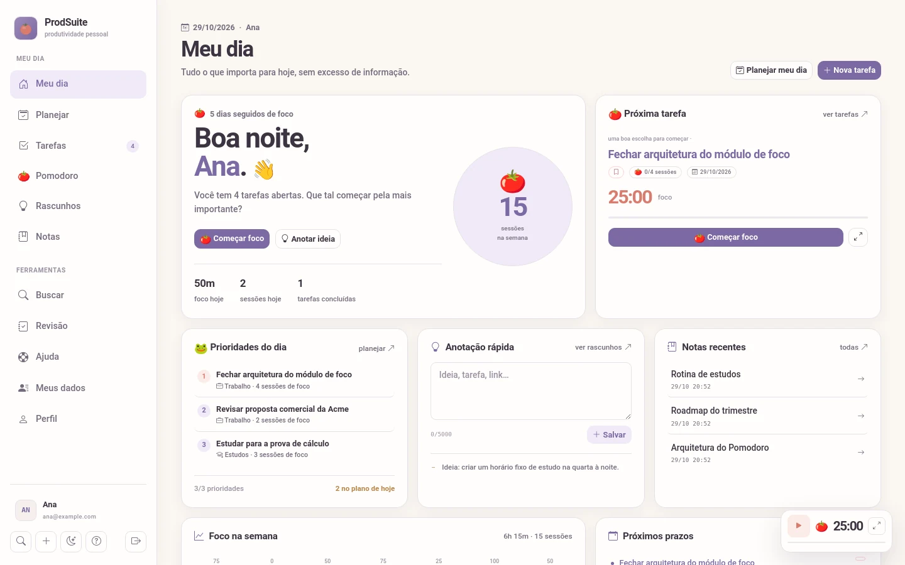
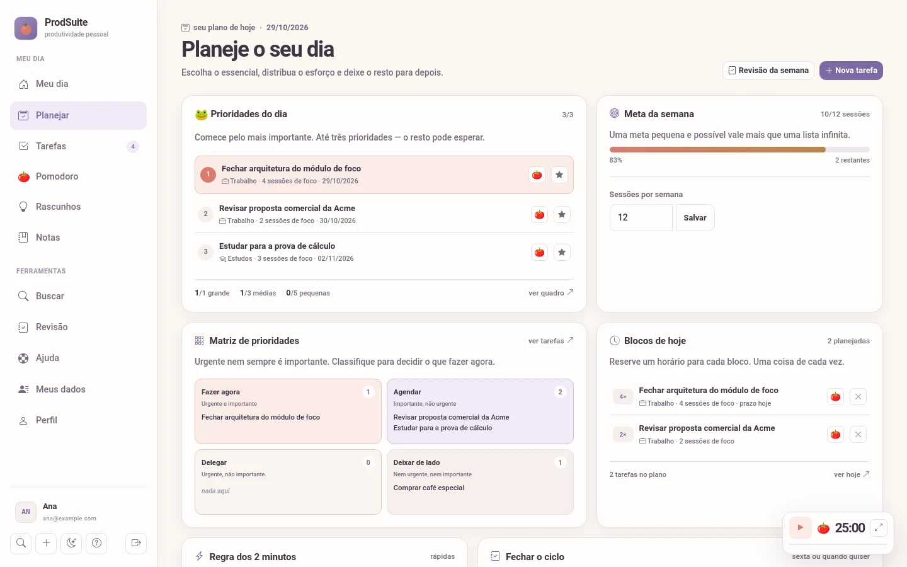
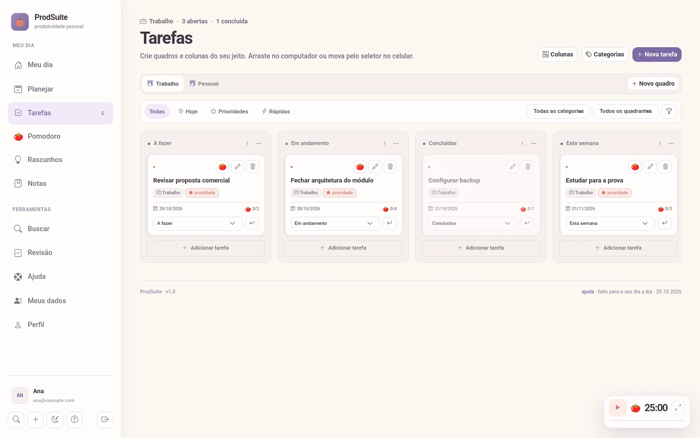
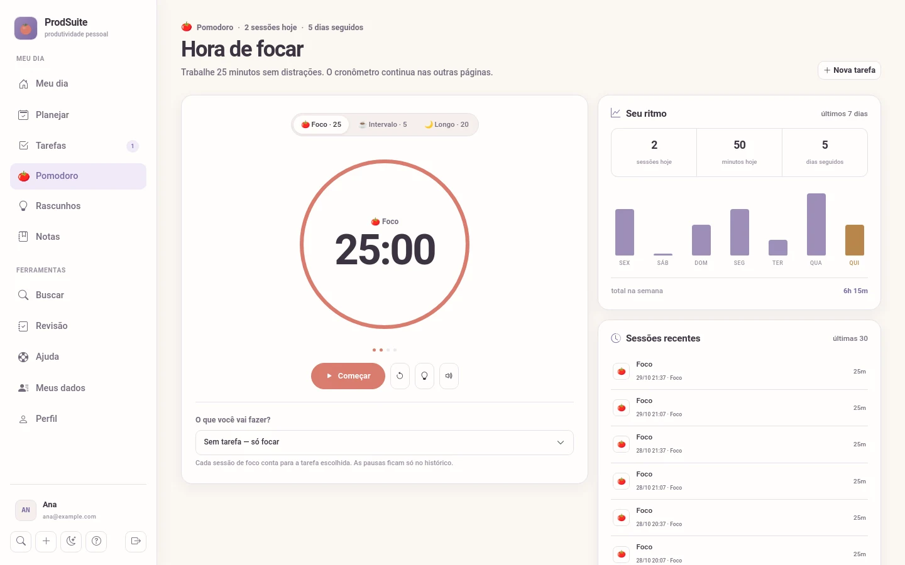
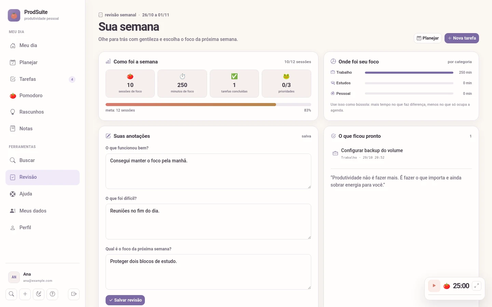
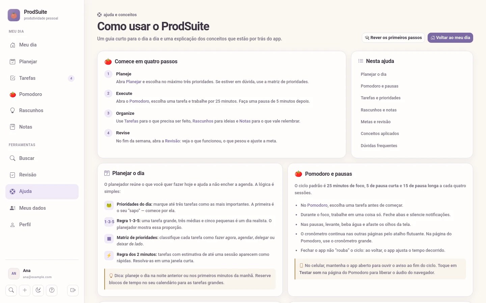
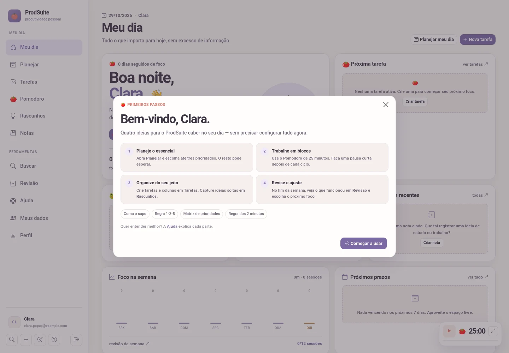
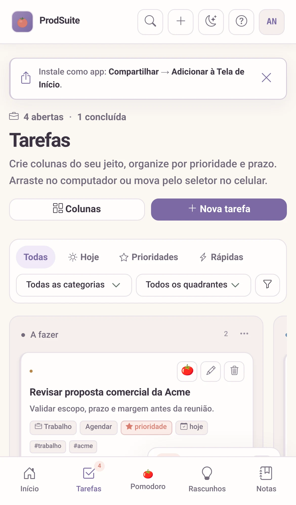
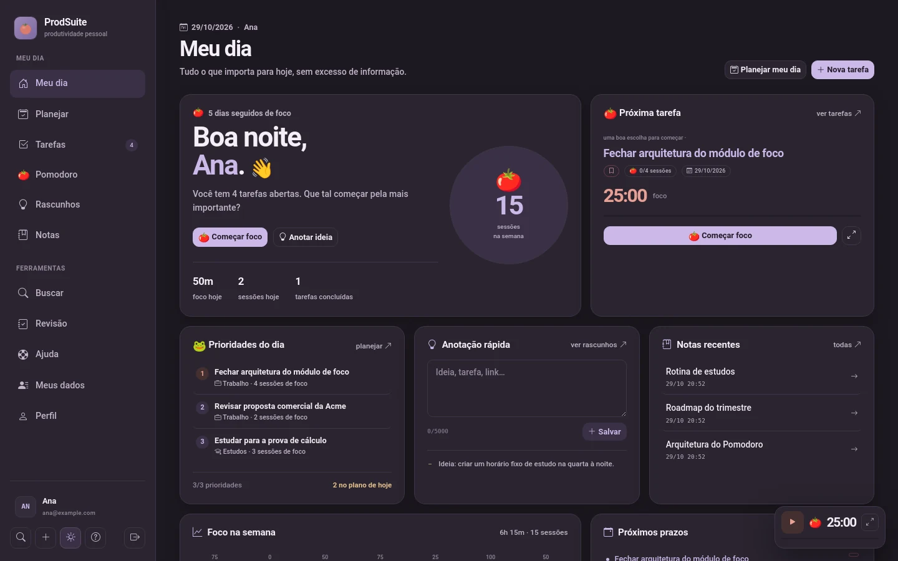

# ProdSuite

### Seu dia, mais leve.

Tarefas, foco, ideias e revisão em um só lugar — para quem quer organizar a rotina sem transformar a vida em uma planilha.

O ProdSuite é um app pessoal de produtividade. Ele junta um quadro de tarefas com colunas do seu jeito, um Pomodoro com pausas, captura rápida de ideias, notas e uma revisão semanal tranquila. Sem feed infinito e sem barulho.



<p align="center"><em>Meu dia: o essencial à vista, sem excesso de informação.</em></p>


---

## Um app que começa pelo essencial

A ideia é simples: você não precisa de mais uma ferramenta para gerenciar a ferramenta. Precisa de um lugar claro para saber **o que importa hoje**, **onde está cada coisa** e **quando parar**.

O ProdSuite foi desenhado em torno de quatro gestos:

1. **Escolher** o que importa.
2. **Focar** em uma coisa por vez.
3. **Guardar** o que não pode ser esquecido.
4. **Revisar** o que funcionou.

O resto é apoio. Você pode usar só uma tarefa e o Pomodoro, ou mergulhar no planejamento completo. O app não cobra que você preencha tudo.

## Um passeio pelo ProdSuite

### Meu dia

A tela inicial reúne suas prioridades, a próxima tarefa, o andamento da semana e um lugar para anotar uma ideia antes que ela fuja.

Você vê rapidamente:

- quantas tarefas estão abertas e quantas foram concluídas;
- as **3 prioridades do dia**;
- a próxima tarefa para começar;
- suas notas e rascunhos recentes;
- o tempo de foco da semana.

### Planejar

Em **Planejar**, você escolhe até três prioridades, distribui o esforço do dia e organiza o resto na matriz de prioridades.



A tela usa ideias conhecidas de gestão do tempo, mas em linguagem comum:

- **Prioridades do dia:** o que precisa acontecer primeiro.
- **Regra 1-3-5:** uma tarefa grande, três médias e cinco pequenas é um dia possível.
- **Matriz de prioridades:** urgente nem sempre é importante.
- **Tarefas rápidas:** até uma sessão de foco, para resolver quando couber no dia.
- **Blocos de hoje:** o que você planejou para o dia, com estimativa de foco.

### Tarefas do seu jeito

O quadro funciona como um Trello pessoal: você cria as colunas que fazem sentido para a sua vida.



Cada coluna é uma lista livre. Para o fluxo ter um fim claro, marque **uma coluna como coluna de conclusão** (por exemplo, Done). Ao mover um card para ela, a tarefa é concluída; ao sair, é reaberta. O app também registra quanto tempo a tarefa passou em cada coluna.

### Foco

O Pomodoro é um tomate, não um cronômetro corporativo.



- 25 minutos de foco, 5 de pausa curta e 20 de pausa longa.
- Você escolhe a tarefa antes de começar.
- O cronômetro continua quando você navega para outra página.
- No fim do ciclo, um som próprio do app, um aviso na tela e o título da aba chamam você de volta.
- A pausa não é recompensa: é parte do método.

### Revisão

No fim da semana, o app vira uma conversa curta com você mesmo.



Você vê o que conseguiu, o que pesou e onde colocou sua energia. Depois escolhe o foco da próxima semana. Sem cobrança, sem ranking, sem vergonha.

### Ajuda

Se bater dúvida, **Ajuda** explica o uso e os conceitos por trás do app. O tour de boas-vindas também pode ser revisto quando quiser.



---

## Como começar a usar

### 1. Crie sua conta

Na primeira vez, você informa **como quer ser chamado** e um nome curto de acesso. O nome de perfil é o que aparece nas boas-vindas e no dia a dia; o nome de acesso serve só para entrar.



Logo depois do cadastro, um pop-up curto apresenta o essencial por cima do app. Se quiser sair, toque no **X**; dá para voltar depois em **Ajuda → Rever os primeiros passos**.

### 2. Crie sua primeira tarefa

Abra **Tarefas** e toque em **Nova tarefa**. Dê um título claro, escolha a coluna e, se quiser, informe prazo, categoria, quadrante, etiquetas e uma estimativa de sessões de foco.

Não precisa preencher tudo. Uma tarefa com título já é um começo.

### 3. Crie seus projetos e colunas

Na primeira vez, **Tarefas ainda não tem nenhum projeto**. Você cria o primeiro e ele nasce totalmente em branco.

1. Abra **Tarefas**.
2. Toque em **Novo projeto**.
3. Dê um nome e toque em **Criar projeto**.
4. No projeto vazio, toque no botão **+ Nova coluna**.
5. Crie as colunas que fizerem sentido: Todo, Doing, Validation, Block, Done ou qualquer outra.

Cada projeto tem as suas próprias colunas e tarefas. Você pode criar vários projetos e alternar entre eles no topo da tela.

Dentro de um projeto, para criar as suas colunas:

1. Abra **Tarefas**.
2. Toque em **Colunas**.
3. Em **Nova coluna**, escreva o nome.
4. Toque em **Criar**.

No mesmo lugar você pode:

- **renomear** uma coluna;
- **mover** a coluna para a esquerda ou direita;
- **excluir** uma coluna — as tarefas dela vão para outra coluna;
- marcar uma coluna como **coluna de conclusão** no gerenciador de colunas.

Para adicionar uma tarefa já dentro de uma coluna, use o botão **Adicionar tarefa** no fim dela. No computador, você também pode arrastar os cartões entre as colunas.

### 4. Crie suas categorias

As categorias servem para separar assuntos: trabalho, estudos, casa, saúde, projetos ou o nome que fizer sentido para você.

1. Abra **Tarefas**.
2. Toque em **Categorias**.
3. Digite o nome, escolha um ícone e toque em **Criar**.
4. Para editar, mude o nome ou o ícone e salve.
5. Para remover, use a lixeira. As tarefas daquela categoria são movidas para outra automaticamente.

Não é obrigatório usar categorias. Elas são uma ajuda para enxergar onde seu tempo está sendo colocado. A conclusão acontece quando o card chega à coluna marcada como conclusão; o tempo em cada coluna fica registrado nos detalhes da tarefa.

### 5. Escolha as prioridades do dia

Abra **Planejar**. Marque até três tarefas como prioridades do dia e classifique o resto na matriz. A primeira prioridade é o seu “coma o sapo”: comece por ela.

Você não precisa planejar a semana inteira. Um dia de cada vez já é suficiente.

### 6. Trabalhe em blocos

Abra o **Pomodoro**, escolha uma tarefa e comece. Quando o ciclo terminar, o app avisa com um som próprio, uma faixa na tela e, se você estiver em outra aba, uma notificação silenciosa.

Faça a pausa. Levante, beba água, olhe para longe. O próximo bloco começa quando você decidir.

### 7. Guarde ideias antes que elas desapareçam

Use o **+** no topo ou a **Anotação rápida** do Meu dia para capturar uma ideia em segundos. Depois, transforme o rascunho em tarefa ou leve o que vale a pena para **Notas**.

As notas aceitam formatação simples, listas e links entre ideias usando `[[outra nota]]`.

### 8. Feche a semana

Abra **Revisão**, responda às três perguntas e olhe para as métricas. Ajuste a meta semanal se a vida pedir outra coisa.

Uma semana mais leve também é uma semana produtiva.

---

## No celular

O ProdSuite foi pensado para caber na mão.



- As colunas ficam lado a lado, com rolagem horizontal.
- Cada cartão tem um seletor para mudar de coluna.
- A navegação inferior mantém o essencial por perto.
- O app pode ser instalado na Tela de Início e abrir sem a barra do navegador.

Para instalar, abra o endereço no navegador do celular e procure **Adicionar à Tela de Início** no menu. No Safari, a opção fica em **Compartilhar**.

> Para ter o app instalável e funcionar offline, o endereço precisa ser seguro (HTTPS). O runbook abaixo explica como fazer isso com Tailscale.

---

## Sua aparência, seu ritmo

O tema claro é o padrão. Se quiser, escolha o escuro no botão de lua/sol do menu ou em **Perfil → Aparência**. A preferência fica salva no dispositivo.



A paleta é pastel de propósito: lavanda, ameixa, papel e tomate. Menos estímulo, mais espaço para pensar.

---

## Instalação com Docker

Se você só quer usar o app, peça o endereço a quem administra a instalação. Se você vai hospedar o seu, o caminho é este.

### O que você precisa

- Docker 24+ com Compose v2.
- Um computador ou servidor que fique ligado quando você quiser acessar o app.
- Cerca de 512 MB de memória disponível para o container.

### 1. Baixe o projeto

```bash
git clone https://github.com/leobarros/prodsuite.git
cd prodsuite
```

### 2. Crie sua configuração

```bash
cp .env.example .env
make secret
```

O `make secret` gera uma chave aleatória e atualiza o `.env`. O arquivo fica fora do Git.

### 3. Suba o app

```bash
docker compose pull
docker compose up -d
docker compose ps
```

A aplicação fica em **http://localhost:8090**. A imagem usada é **`nickolback/prodsuite:latest`**, com `pull_policy: always`; o container publica a porta **8090** no host e guarda os dados no volume `prodsuite_data`.

> Não use a porta `5060`: o Firefox a bloqueia por ser reservada a SIP. A `8090` foi escolhida por não conflitar com as portas usuais de Grafana, Prometheus, Loki e Alertmanager. Se estiver ocupada, defina outra porta segura em `APP_PORT`, como `8095` ou `18080`.

### 4. Crie sua conta

Abra **http://localhost:8090**, crie a conta e faça o tour.

Se preferir criar a primeira conta pelo terminal:

```bash
docker compose exec app flask --app app create-user
```

### 5. Feche o registro

Depois de criar a sua conta, edite o `.env`:

```env
ALLOW_REGISTRATION=false
```

E recrie o container:

```bash
docker compose up -d --force-recreate
```

### Verificação rápida

```bash
curl http://127.0.0.1:8090/healthz
# {"status":"ok"}
```

Pronto. Para acessar pelo celular com HTTPS, fazer backup, atualizar ou resolver problemas, siga o **[Runbook do ProdSuite](docs/RUNBOOK.md)**.

---

## Para quem cuida da infraestrutura

O **[Runbook](docs/RUNBOOK.md)** reúne os procedimentos técnicos:

- instalação e atualização com Docker;
- variáveis de ambiente;
- Tailscale e HTTPS para o celular;
- backup e restauração do volume;
- teste de fumaça pós-instalação;
- testes automatizados;
- segurança e auditoria de dados;
- diagnóstico de problemas.

O README fica com a apresentação e o guia de uso. O runbook fica com a operação.

---

## Para quem quer desenvolver

```bash
python3 -m venv .venv
source .venv/bin/activate
pip install -r requirements-dev.txt

flask --app app init-db
flask --app app run --debug
```

Testes:

```bash
pytest -q
# 105 testes
```

A suíte cobre autenticação, sessões, CSRF, persistência da conta, tarefas, colunas personalizadas, rascunhos, notas, busca, Pomodoro, planejamento, revisão, onboarding, ajuda, exportação e PWA.

O banco local fica em `instance/prodsuite.db`. Ele não é apagado ao sair da conta. Para guardar uma cópia local:

```bash
make backup-local
```

---

## Referências de método

A camada de planejamento foi inspirada em:

- [Gestão do tempo — Alura](https://www.alura.com.br/artigos/gestao-do-tempo)
- [20 dicas de produtividade — ClickUp](https://clickup.com/pt-BR/blog/36442/dicas-de-produtividade)

O ProdSuite não é uma cópia desses métodos. É uma tentativa de aplicar o que funciona em um app pequeno, pessoal e sem pressa.

---

**ProdSuite v1.0** — feito para o seu dia a dia e o seu ritmo.
