# ProdSuite

### Seu dia, mais leve.

**Tarefas, foco, notas e cuidado pessoal em um só lugar.**
Um app pessoal e auto-hospedado para organizar o que importa sem transformar a vida em uma planilha.


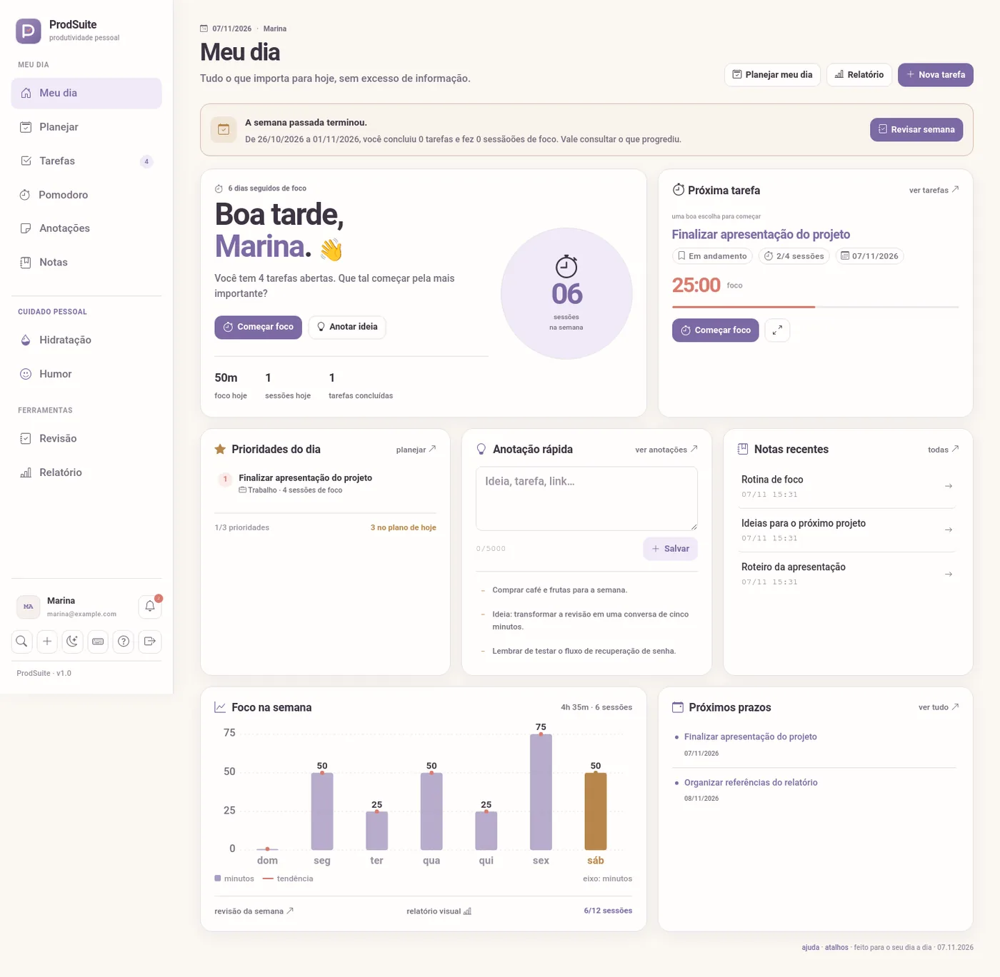

<p align="center"><em>Meu dia: prioridades, foco e próximos passos sem excesso de informação.</em></p>

---

## Índice

- [Por que ProdSuite](#por-que-prodsuite)
- [Conheça as funções](#conheça-as-funções)
- [Primeiros passos](#primeiros-passos)
- [No celular](#no-celular)
- [Instalação](#instalação)
- [Notificações](#notificações)
- [Segurança e operação](#segurança-e-operação)
- [Desenvolvimento](#desenvolvimento)
- [Documentação](#documentação)

---

## Por que ProdSuite

O ProdSuite parte de uma ideia simples: você não precisa de mais uma ferramenta para gerenciar a ferramenta.

Ele reúne o essencial em uma rotina curta:

1. **Escolher** o que importa hoje.
2. **Focar** em uma coisa por vez.
3. **Guardar** o que não pode ser esquecido.
4. **Cuidar** do corpo e do humor.
5. **Revisar** o que funcionou.

Sem feed infinito, sem ranking e sem cobrança. Você pode usar só uma tarefa e o Pomodoro, ou aproveitar o sistema completo.

---

## Conheça as funções

### Meu dia

A tela inicial mostra o que precisa da sua atenção agora:

- próximas tarefas e prioridades do dia;
- andamento do foco na semana;
- captura rápida para não perder uma ideia;
- notas recentes;
- prazos próximos.


### Tarefas

Um quadro com as colunas que fizerem sentido para você.

- crie quantos projetos quiser;
- organize tarefas em colunas personalizadas;
- arraste cartões para mudar o estágio;
- use prioridade, categoria, prazo, estimativa de foco e etiquetas;
- anexe arquivos ou cole/arraste um print diretamente na tarefa;
- marque uma coluna como conclusão para fechar o ciclo.

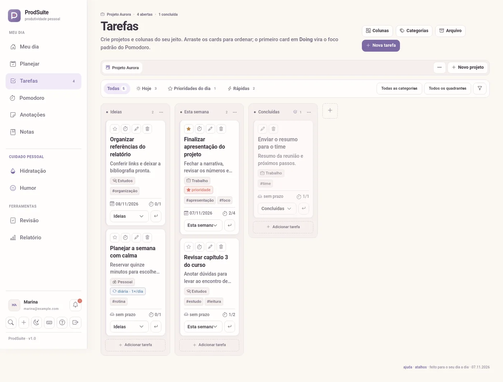

### Planejar

Planeje um dia possível, não um dia ideal.

- escolha até três prioridades;
- distribua tarefas por esforço;
- use a matriz de urgência e importância;
- veja os blocos planejados para hoje;
- identifique tarefas rápidas.

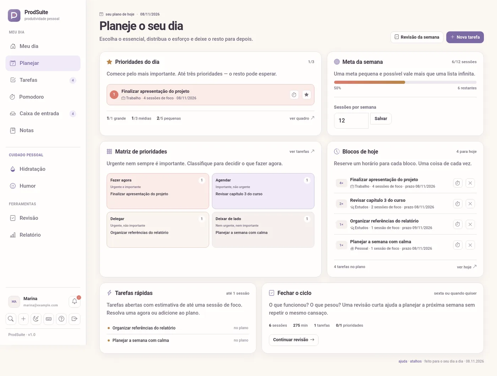

### Pomodoro

Foco com começo, pausa e fim.

- ciclos de foco, pausa curta e pausa longa;
- escolha a tarefa antes de começar;
- o timer continua enquanto você navega;
- som e notificação ao terminar;
- as pausas fazem parte do método.

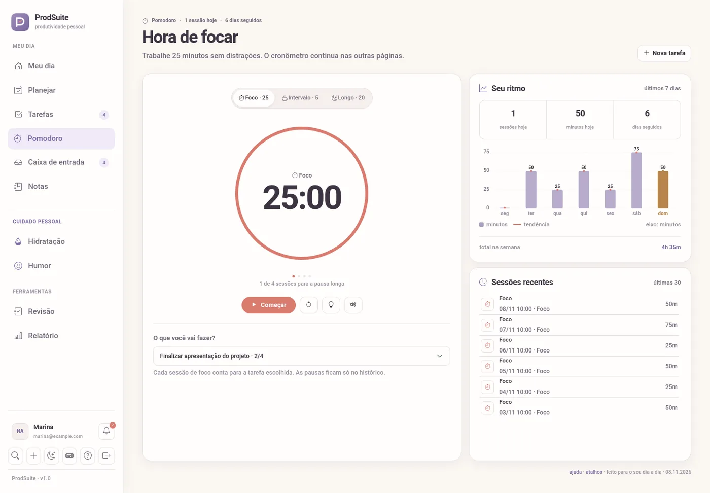

### Caixa de entrada

O lugar para o que ainda não precisa virar tarefa, nota ou obrigação.

- capture em segundos, sem projeto, prazo ou prioridade;
- decida depois: **virar tarefa**, **virar nota**, **Talvez**, **Feito** ou **soltar**;
- use **Decidir um por um** para esvaziar a cabeça no modo foco;
- itens de **Talvez** descansam fora da fila de decisão;
- o que foi resolvido continua consultável em **Resolvidas**.

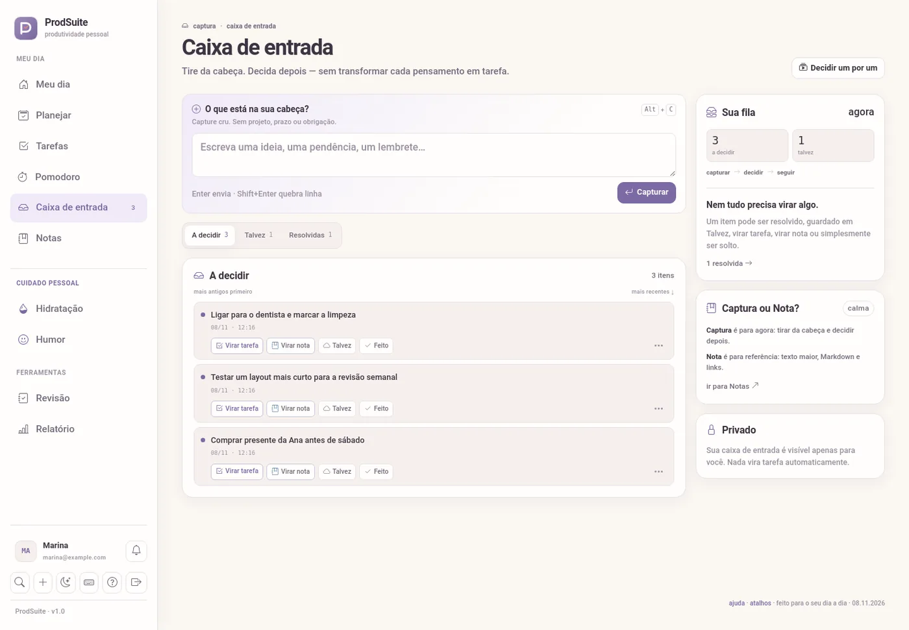

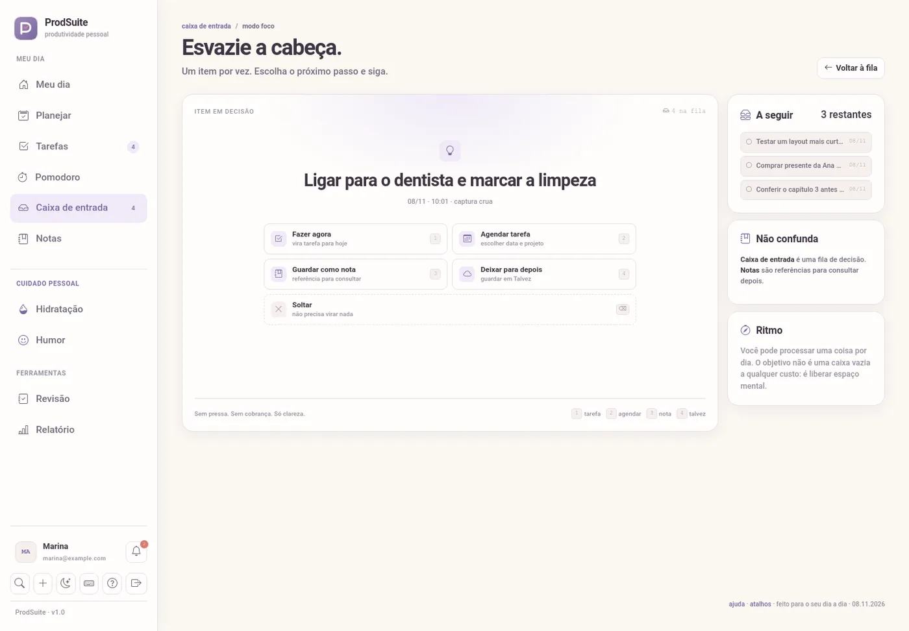

### Notas

Um espaço para ideias que merecem continuar.

- escrita em Markdown e prévia renderizada no mesmo espaço;
- listas e links;
- links entre notas com `[[outra nota]]`, abertos em nova aba;
- busca no conteúdo;
- tags na lateral para filtrar notas e seguir uma linha de pensamento.

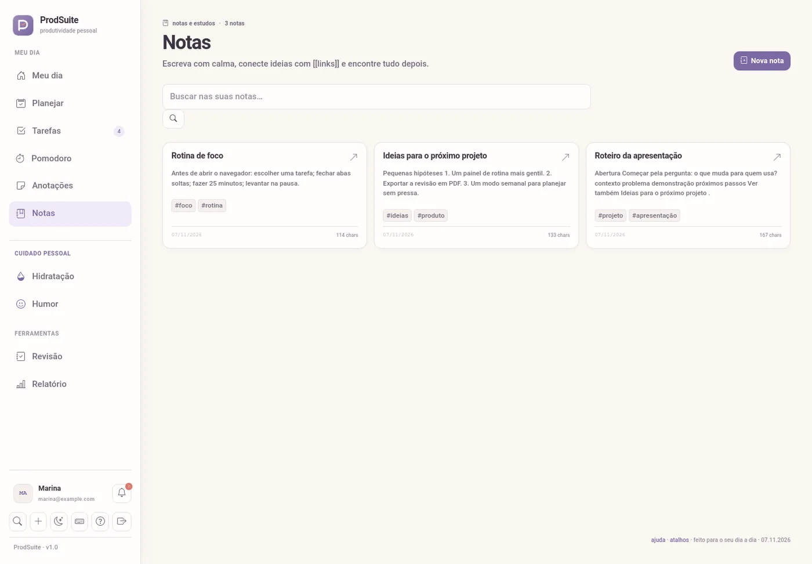

### Hidratação

Registre água e outras bebidas sem tratar tudo como água.

- água, café coado, espresso, chá, cerveja, vinho, destilado e outras bebidas;
- meta de hidratação calculada pelo peso;
- barra líquida com a participação de cada bebida;
- compensação alcoólica estimada;
- histórico recente e visão semanal.

O resultado é uma **estimativa**, não uma prescrição médica.

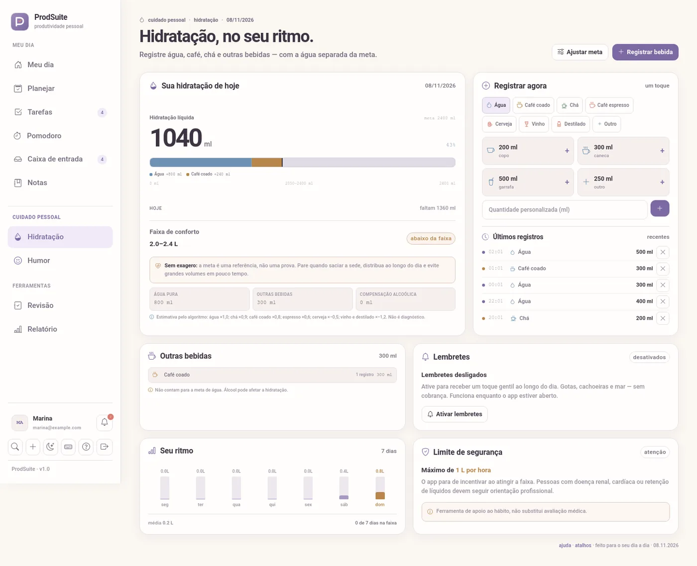

### Humor

Um check-in curto para perceber padrões.

- humor, energia e tensão em escalas de 1 a 5;
- contextos como sono, trabalho, estudos, relações, corpo e família;
- radar de frequência e contexto;
- comparação com a semana anterior;
- análise de impacto com médias de humor, energia e tensão por contexto.

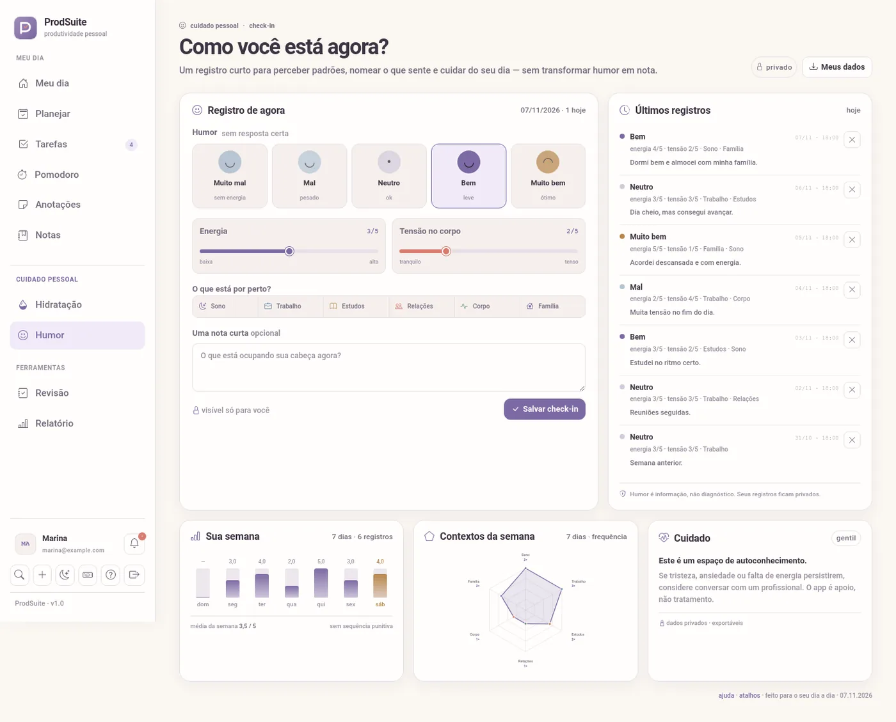

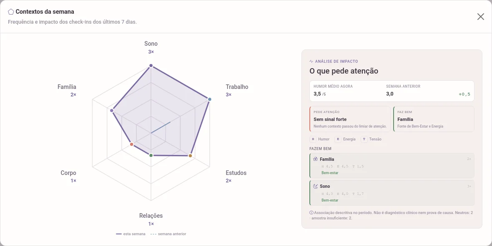

### Revisão

No fim da semana, o app vira uma conversa curta com você mesmo.

Três perguntas:

- O que funcionou?
- O que foi difícil?
- Qual é o foco da próxima semana?

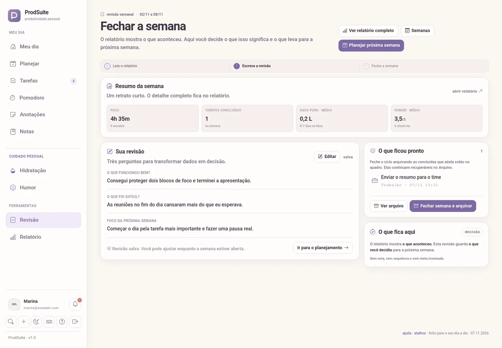

### Relatório

Uma leitura dos seus dados, sem transformar a semana em uma nota.

- foco e tarefas por dia;
- água e outras bebidas;
- humor e contextos;
- comparação com a semana anterior;
- download em PDF.

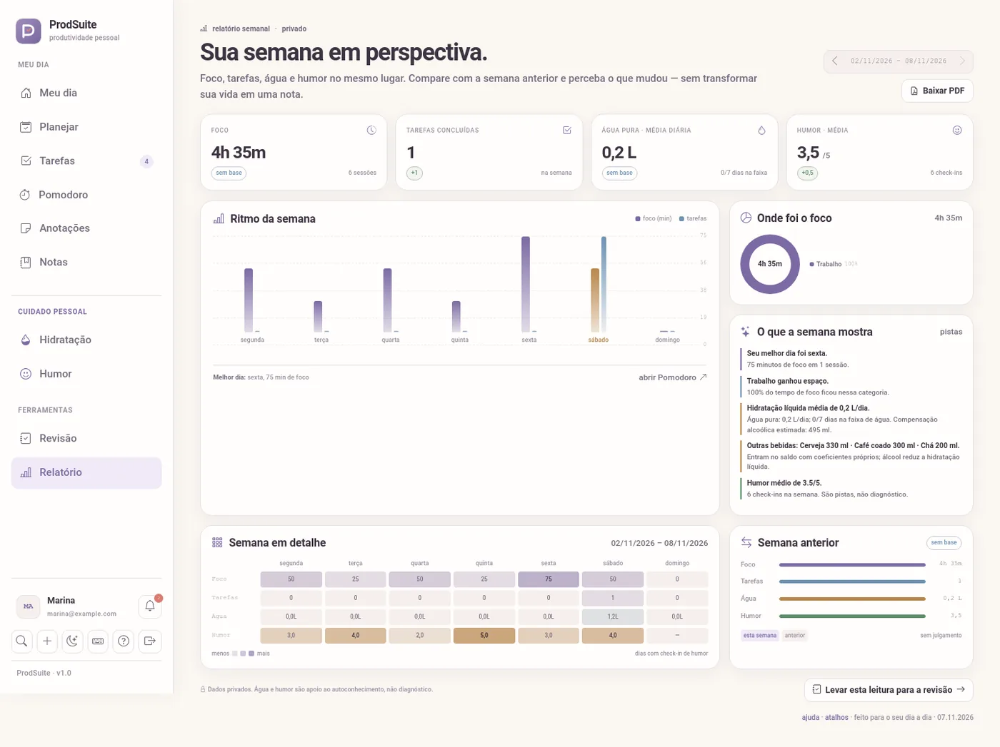

### TUI beta

Existe uma versão local em terminal, separada do app web e sem Docker:

```bash
curl -fsSL https://raw.githubusercontent.com/leobarros/prodsuite/main/tui/install.py -o /tmp/prodsuite-tui-install.py
python3 /tmp/prodsuite-tui-install.py
prodsuite-tui
```

O instalador detecta Linux/Debian, macOS e Windows, cria um ambiente isolado e
usa um banco SQLite local. Veja [tui/README.md](tui/README.md).

## Notificações

Lembretes discretos para a rotina:

- check-in de humor antes do fim do expediente;
- revisão semanal;
- prazos de tarefas;
- horário silencioso configurável;
- central interna e histórico.

O sino ao lado do perfil mostra as notificações das últimas 2 horas.

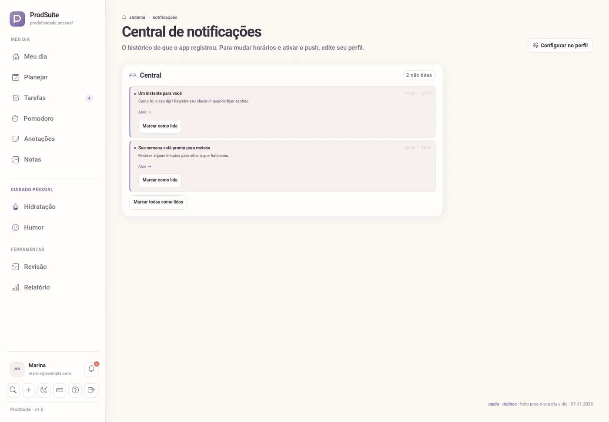

### Perfil e preferências

Cada pessoa configura o próprio ritmo:

- fuso horário;
- semana e horário de trabalho;
- notificações;
- tema;
- segurança da conta;
- exportação dos próprios dados.

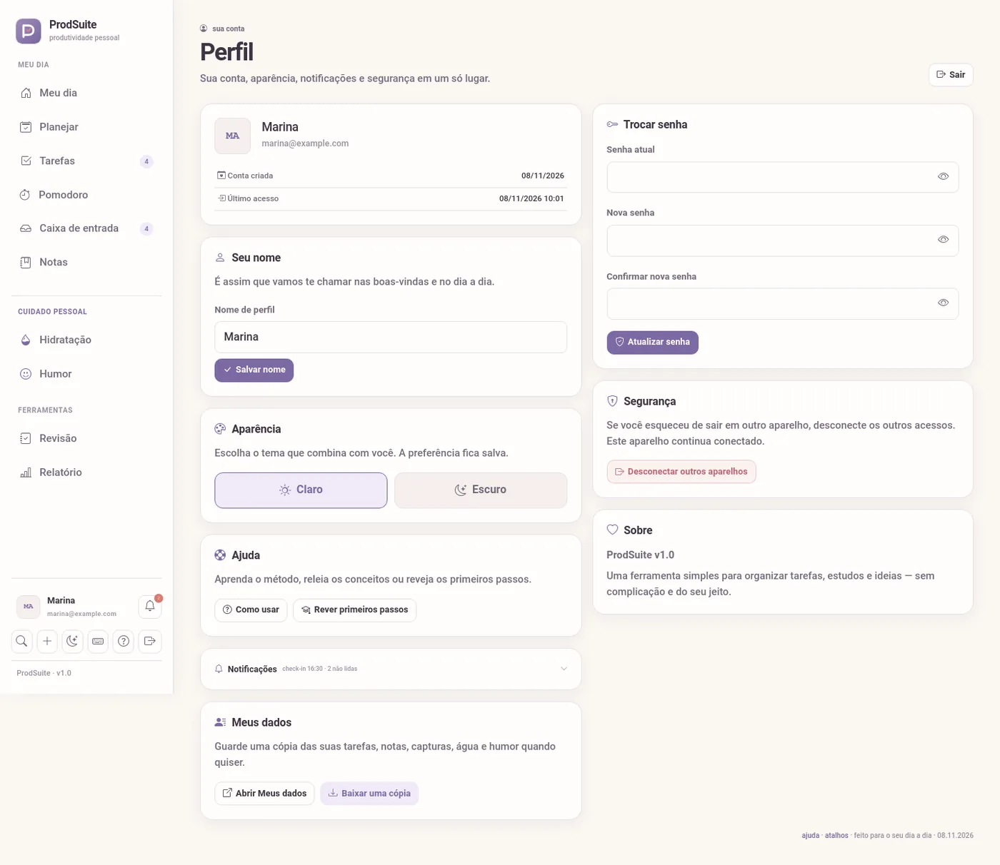

---

## Primeiros passos

### 1. Crie sua conta

Abra o app, informe como quer ser chamado e crie seu acesso. O nome de perfil aparece nas boas-vindas; o usuário de acesso serve para entrar.

### 2. Crie um projeto e suas colunas

Abra **Tarefas** e crie o primeiro projeto. Depois crie as colunas que representam seu fluxo: ideias, esta semana, em andamento, concluídas — ou qualquer nome que funcione para você.

### 3. Coloque uma tarefa no lugar

Adicione uma tarefa com título claro. Prazo, categoria, prioridade e estimativa são opcionais.

### 4. Escolha o essencial

Abra **Planejar** e marque até três prioridades do dia. O resto pode esperar.

### 5. Faça um bloco de foco

Abra **Pomodoro**, escolha uma tarefa e comece. Quando o ciclo terminar, faça a pausa de verdade.

### 6. Registre o dia

Use **Hidratação** e **Humor** para registrar o que o corpo e a cabeça pedirem. Não precisa preencher tudo.

### 7. Feche a semana

Abra **Revisão**, responda às três perguntas e consulte o **Relatório** para enxergar o que mudou.

---

## No celular

O ProdSuite é instalável como PWA:

- abra o endereço HTTPS no navegador do celular;
- use **Adicionar à Tela de Início**;
- o app abre sem a barra do navegador;
- a navegação inferior mantém o essencial por perto.

Para instalar e usar Web Push, o endereço precisa ser **HTTPS**. Veja [docs/HTTPS.md](docs/HTTPS.md).

---

## Instalação

### Com Docker

Requisitos: Docker 24+ com Compose v2 e cerca de 512 MB de memória.

```bash
git clone https://github.com/leobarros/prodsuite.git
cd prodsuite
cp .env.example .env
make secret
docker compose pull
docker compose up -d --wait
docker compose ps
```

Abra:

```text
http://localhost:8090
```

Para criar a primeira conta pelo terminal:

```bash
docker compose exec app flask --app app create-user
```

Depois de criar sua conta, feche o registro:

```env
ALLOW_REGISTRATION=false
```

```bash
docker compose up -d --force-recreate
```

Verificação rápida:

```bash
curl http://127.0.0.1:8090/healthz
# {"status":"ok"}
```

### Build local

```bash
docker build -t nickolback/prodsuite:latest .
docker compose up -d --force-recreate --pull never
```

### Desenvolvimento

```bash
python3 -m venv .venv
source .venv/bin/activate
pip install -r requirements-dev.txt
flask --app app init-db
flask --app app run --debug
```

Testes:

```bash
pytest -q
# 171 testes
```

O banco local fica em `instance/prodsuite.db` e não é apagado ao sair da conta.

---

## Notificações

As notificações são configuradas em **Perfil → Notificações**.

O check-in de humor é calculado **30 minutos antes do fim do expediente**. A semana de trabalho é configurável, incluindo sábado e domingo para quem trabalha nesses dias.

Para Web Push com o app fechado:

1. configure `VAPID_PUBLIC_KEY`, `VAPID_PRIVATE_KEY` e `VAPID_SUBJECT`;
2. acesse por HTTPS;
3. ative o push no dispositivo;
4. execute o agendador periodicamente:

```bash
docker compose exec -T app flask --app app notifications-run
```

O agendador respeita o fuso de cada usuário, o horário silencioso e evita duplicidades.

---

## Segurança e operação

- Imagem Docker compatível com x86-64 baseline.
- Runtime sem `pip`, `setuptools` ou `wheel`.
- WeasyPrint atualizado para geração segura do PDF.
- Trivy sem achados **HIGH/CRITICAL** na verificação atual:

```bash
make scan
```

- Dados ficam no volume Docker `prodsuite_data`.
- O relatório e o PDF são privados.
- Notas íntimas não entram no relatório.
- Backup frio:

```bash
make backup
```

- Backup do banco local:

```bash
make backup-local
```

Mais detalhes:

- [Runbook de operação](docs/RUNBOOK.md)
- [Segurança da imagem](docs/SECURITY.md)
- [Compatibilidade de CPU](docs/CPU_COMPATIBILITY.md)
- [HTTPS local e Docker](docs/HTTPS.md)

### Stack

- Python 3.13 + Flask 3
- SQLAlchemy + SQLite em WAL
- Gunicorn `gthread`
- Bootstrap local + CSS/JS próprios
- PWA com Service Worker
- WeasyPrint para PDF
- Web Push para notificações

---

## Documentação

| Documento | Conteúdo |
|---|---|
| [RUNBOOK](docs/RUNBOOK.md) | Instalação, atualização, backup, HTTPS, Tailscale, diagnóstico |
| [HTTPS](docs/HTTPS.md) | mkcert, Caddy local e Tailscale Serve |
| [SECURITY](docs/SECURITY.md) | Imagem, scan Trivy e política de atualização |
| [CPU_COMPATIBILITY](docs/CPU_COMPATIBILITY.md) | Requisitos para homelabs com CPUs antigas |
| [DESIGN_SYSTEM](docs/DESIGN_SYSTEM.md) | Tokens, componentes e regras visuais |

---

## Um app para o seu ritmo

O ProdSuite não tenta preencher cada minuto do dia. Ele tenta deixar espaço para o que importa — e para parar quando for hora.

**ProdSuite v1.0**
Feito para o seu dia a dia e o seu ritmo.
